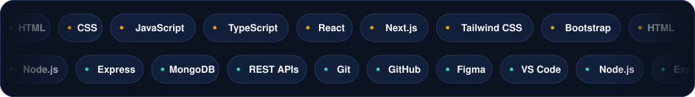
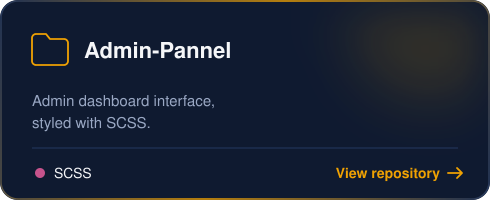
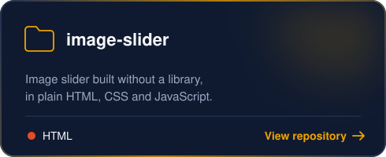
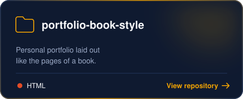
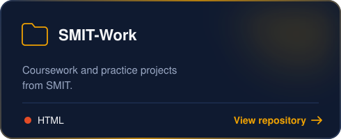
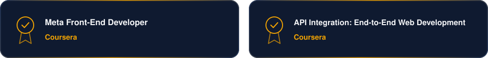
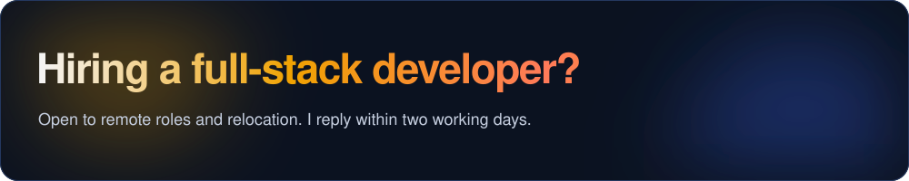

  
  
  

## About

I am a full-stack developer from Peshawar, Pakistan. I build MERN applications, integrate third-party APIs and automate repetitive work. I am looking for a junior or mid-level full-stack role, remote or abroad.

## What I do

## Selected work

<table>
  <tr>
    <td width="50%"></td>
    <td width="50%"></td>
  </tr>
  <tr>
    <td width="50%"></td>
    <td width="50%"></td>
  </tr>
</table>

More repositories on [GitHub](https://github.com/aamir-ullah-offical?tab=repositories).

## Experience

## Certifications

  
  

